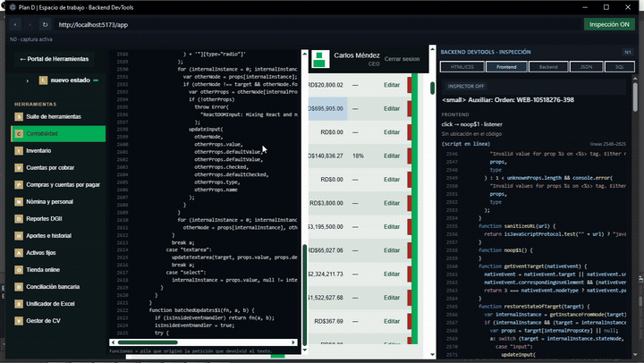
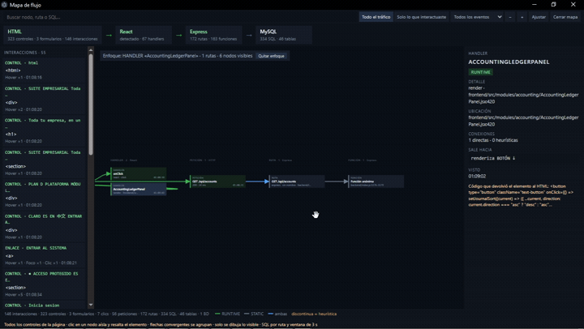

# Fullstack DevTools

Devtools de escritorio para seguir una cadena completa de una aplicación web local:

**elemento de la interfaz → manejador del frontend → petición HTTP → ruta y función del backend → consulta SQL → base de datos**

La aplicación se llama **Backend DevTools Desktop** en la interfaz; el repositorio se publica como **Fullstack DevTools**.

Licencia MIT · v0.2.0 · Desarrollado y probado en Windows

## Demostración

[](media/demo.mp4)

[Ver el video completo (69 s, MP4, 4,9 MB)](media/demo.mp4)

El video recorre el flujo completo sobre una aplicación local: selección del elemento, resolución del manejador del frontend, petición HTTP, ruta del backend, cuerpos JSON y consulta SQL. La vista previa es un GIF de 8 s; GitHub no reproduce MP4 dentro del README ni en la vista de archivos, así que el enlace permite descargar el video completo.

[](media/demo-2.mp4)

[Ver el segundo video completo (40 s, MP4, 2,3 MB)](media/demo-2.mp4)

La segunda demo se centra en el mapa de flujo en su propia ventana: capas ordenadas por hora con HH:MM:SS, enfoque compacto de un nodo, recorte de lo que queda fuera del visor y flechas convergentes agrupadas en un solo tronco.


## Qué incluye

- **Cinco modos de inspección**: HTML/CSS, Frontend, Backend, JSON y SQL. Cada modo añade una capa de procedencia al mismo elemento seleccionado.
- **Selección exacta del elemento**: el hover y el clic usan la referencia real del evento de puntero, también dentro de Shadow DOM; el resaltado sigue al puntero y el tooltip de procedencia está apagado por defecto: se enciende con el botón «Tooltip» de la barra o manteniendo Shift.
- **Manejador del frontend y trazado en ejecución**: listener asociado, pila de iniciadores y props de React o Vue. Para un texto formateado en pantalla, como «RD$ 1,500.00», el inspector identifica el objeto de respuesta que alimentó el componente, la función y la línea JSX que lo renderizan (React 18 con `_debugSource`; React 19.1+ con `_debugStack` y el source map inline del módulo servido; React 19.0 con la definición del componente), la subfunción que ejecutó la petición y la cadena petición → ruta → SQL → base de datos.
- **Rutas del backend**: índice estático para Express, Fastify, FastAPI y Flask, con función, archivo y línea.
- **Enlaces al código**: cada `archivo:línea` del panel, del mapa, del registro, de la consola y de la cronología es un enlace. Al pulsarlo, la ventana principal pasa al frente, abre el archivo en el editor y marca el rango completo de la función —de la línea inicial a `endLine`—. Las URL locales del frontend se resuelven al archivo del proyecto; las ubicaciones fuera del proyecto abierto se rechazan.
- **Mapa de flujo**: ventana propia con la vista de conjunto de **todos los controles de la página** (botones, enlaces, campos, formularios, `details`, editables y el documento), usados o no, y **todas las interacciones** de la sesión: clic, doble clic, menú contextual, envío, entrada, cambio, foco, pérdida de foco, teclas de control, hover y scroll. Dibuja elemento → manejador → petición → ruta → función → SQL → tabla/BD, y muestra hacia dónde conecta cada control, qué formulario envía qué petición y los destinos declarados (`href`, `action`) aunque no haya tráfico. Incluye evidencia STATIC/RUNTIME, correlación directa o heurística, búsqueda clicable que enfoca todas las rutas alcanzables desde un control —y que también encuentra por estado de la petición (código, frase, categoría `4xx`/`5xx`, «pendiente» o `ERR`) y por SQL—, dos modos («Todo el tráfico» y «Solo lo que interactuaste», que oculta el resto del grafo y re-apila solo lo alcanzable desde lo que tocaste), filtro por evento —que solo ilumina los nodos alcanzables desde el evento elegido—, casilla «Solo esos» —que oculta y re-apila como «Ver interacciones» y puede marcarse incluso sin un evento elegido, en cuyo caso toma el primero disponible—, zoom y detalle por nodo. Las aristas se colorean por dirección y no llevan texto: azul = envío (sale por la derecha), verde = recibo (sale por la izquierda), ámbar = gateway HTTP y violeta = servidor. Una flecha doble en ambos extremos marca ida y vuelta observada —respuesta capturada en gateway y ejecución con una respuesta capturada en la misma cadena para servidor—; las conexiones pendientes o sin esa evidencia quedan con una sola flecha y las solo estáticas se atenúan. Las heurísticas siguen discontinuas. El tooltip está apagado por defecto y se enciende con el botón «Tooltip» o manteniendo Shift. El clic izquierdo ilumina toda la cadena del nodo —ancestros y descendientes— sin mover el mapa; el clic derecho abre un menú con «Ver interacciones» para aislar ancestros y descendientes, re-apilar y ajustar la vista, y con «Quitar enfoque» para volver al grafo completo. Cada capa se apila por hora de primera aparición y las tarjetas, el rail y las listas muestran HH:MM:SS en orden cronológico. La página queda visible en su ventana mientras el mapa ocupa otra, y el nodo elegido se centra y se ilumina en la página con el mismo recuadro del hover. El SVG solo monta los nodos y aristas que caen dentro del visor más un margen de 280 px, y los recicla al desplazar, acercar o redimensionar. Las flechas que convergen en un mismo destino se agrupan en un tronco: cada origen dibuja una rama hasta un punto común y desde allí sale una sola flecha hacia el destino. Al hacer clic derecho en un nodo y elegir «Ver interacciones» se ocultan los nodos ajenos a su cadena —ancestros y descendientes— y el subgrafo restante se vuelve a apilar y ajustar a la pantalla; un clic en el vacío quita la selección y el enfoque y restaura el grafo completo. y «Cerrar mapa», la X de la ventana o `Escape` cierran la ventana. Las listas del mapa renderizan 20 elementos por bloque y cargan más al desplazarse, sin descartar datos. Cada nodo indica cuántas veces se usó —«Interacciones», «Ejecuciones», «Peticiones recibidas»/«manejadas» o «Consultas ejecutadas» según su tipo— cuando el recuento supera uno. El texto del SVG no es seleccionable; el detalle del nodo y las listas laterales sí, así que el texto copiable es el del panel. La tira superior resume la cadena de tecnologías detectada (por ejemplo HTML → React → Express → MySQL) con flechas que se encienden cuando el dato recorrió ese tramo durante la sesión. El hover en los modos de procedencia registra la cadena en ejecución y el mapa la dibuja como arista del elemento a la petición capturada —o a la ruta ejecutada si no hay respuesta capturada— y del componente que lo renderizó al elemento, rotulada como identidad, coincidencia de contenido o directa según la evidencia, así que la cadena del tooltip queda conectada sin depender de la ventana de 3 s de un clic.
- **Tráfico completo**: todas las peticiones de la sesión, sin recortes, en orden cronológico, con hora, duración, ping y correlación `CLIC`/`FONDO`. Los cuerpos JSON se capturan enmascarados.
- **Estado de ciclo de vida**: cada petición indica su punto real —enviada y esperando respuesta, enviada sin respuesta (`ERR`), respuesta con código y frase en español, o respuesta recibida con ejecución del backend capturada o no—, y ese estado se puede buscar en el mapa, en el panel de inspección y en la pestaña Peticiones por código (`404`), frase («No encontrado»), categoría (`4xx`/`5xx`), «pendiente», «ERR» o evidencia del backend.
- **Consola cronológica**: todos los `console.log`, avisos, errores y excepciones de la página y del frontend lanzado, más la salida `stdout`/`stderr` del backend, ordenados por hora con milisegundos y ubicación. Filtros «Todo», «Frontend», «Backend» y «Solo problemas», con contador de problemas en la pestaña.
- **SQL en runtime y estático**: consultas observadas en `pg`, `mysql2`, `mysql`, `sqlite3` y `better-sqlite3`; análisis estático para MySQL, PostgreSQL y SQLite, con tablas y columnas.
- **Ejecución N2**: pausa en el manejador y código en ejecución mediante Node Inspector. La app puede arrancar el backend con `--inspect` o conectarse a uno ya arrancado.
- **Registro de actividad**: todo lo que ocurre en la sesión, en orden, con filtros por categoría.
- **Navegador integrado**: ventana propia con barra de URL, o vista embebida, con la aplicación inspeccionada aislada.
- **Editor con guardado explícito**: lectura del proyecto y edición solo cuando tú guardas.
- **Evidencia honesta**: cada dato se etiqueta como STATIC o RUNTIME; el código detectado nunca se presenta como ejecutado.

## Requisitos

- Node.js 22.22 o superior y npm.
- El proyecto a inspeccionar debe servirse en un origen local (`localhost`, `127.0.0.1` o `::1`) o en un origen añadido a la lista permitida.
- Desarrollado y probado en Windows 10/11. Electron permite macOS y Linux, pero esta versión no se ha verificado allí.

## Descarga

Binarios para Windows x64 en [Releases](https://github.com/geoni15/fullstack-devtools/releases/latest):

- [Instalador](https://github.com/geoni15/fullstack-devtools/releases/download/v0.2.0/Backend-DevTools-Desktop-0.2.0-setup.exe): instala por usuario y permite elegir la carpeta.
- [Versión portable](https://github.com/geoni15/fullstack-devtools/releases/download/v0.2.0/Backend-DevTools-Desktop-0.2.0-portable.exe): un solo ejecutable, sin instalación.

Los binarios no están firmados; Windows SmartScreen puede mostrar una advertencia.

## Instalación y uso

```bash
git clone https://github.com/geoni15/fullstack-devtools.git
cd fullstack-devtools
npm install
npm run dev
```

Para ejecutar la versión compilada usa `npm start`. Para empaquetar en Windows usa `npm run package:win`, que genera el instalador NSIS y el ejecutable portable en `release/`; `npm run package:dir` genera solo la carpeta sin empaquetar.

Flujo de trabajo:

1. Abre la carpeta del proyecto; el acceso queda limitado a esa raíz.
2. Arranca el backend desde la app (se lanza con `--inspect` cuando está configurado) o conéctate a uno en marcha.
3. Carga la URL del frontend en el navegador integrado y activa «Inspección ON».
4. Haz hover sobre un elemento y mantén Shift (o fija el botón «Tooltip» de la barra del navegador) para ver su procedencia; el clic abre la tarjeta de inspección. Shift sigue funcionando aunque el foco esté en el panel de inspección o en los botones HTML/CSS, Frontend o Backend.
5. Recorre los modos del panel y selecciona una petición para ver su ruta, su estado, su SQL y su ejecución; el buscador de peticiones acepta código, frase de estado, categoría, «pendiente» o «ERR».
6. Abre la pestaña «Consola» para seguir en orden cronológico los mensajes de la página y la salida del backend; alterna «Todo», «Frontend», «Backend» o «Solo problemas».
7. Abre «Mapa» en la cabecera del panel: el mapa aparece en su propia ventana, con cada capa en orden cronológico y hora HH:MM:SS, y la página sigue visible en la otra. La tira superior muestra HTML → frontend → backend → base de datos con flechas que se encienden al circular el dato. El inventario incluye todos los controles aunque no los hayas tocado; cada movimiento se agrega en el rail de interacciones y el filtro por evento solo ilumina los nodos alcanzables desde el evento elegido; la casilla «Solo esos» oculta el resto y re-apila el subgrafo como «Ver interacciones» al instante, también sin haber elegido un evento: se marca y toma el primero disponible; mientras no haya eventos, el mapa lo indica y aplica el filtro en cuanto llegan. Al abrir el mapa, todos los controles inventariados y los ya interactuados se resuelven sin esperar eventos: se dibujan el manejador real, el componente que los renderiza y la cadena dato → petición → ruta con evidencia RUNTIME; los controles que aun así queden sin aristas se enlazan por contención DOM, que describe jerarquía y no flujo de datos. Escribe en el buscador y pulsa un resultado para enfocar todas las rutas alcanzables desde ese control; el buscador también encuentra por estado de la petición (código, frase, categoría, «pendiente» o «ERR») y por SQL. El clic izquierdo en un nodo ilumina toda su cadena —ancestros y descendientes—, y el clic derecho → «Ver interacciones» aísla y recompacta esa cadena. Mantén Shift o activa «Tooltip» para ver el detalle: el color indica envío, recibo, gateway o servidor, la doble flecha marca ida y vuelta observada, y el recuento indica cuántas veces se usó el nodo. Los botones «Todo el tráfico» y «Solo lo que interactuaste» cambian el alcance; el segundo solo considera interactuados los elementos con eventos o trazas, no los resueltos en segundo plano. Las listas muestran 20 elementos por bloque y cargan más al desplazarse. El dibujo solo mantiene montados los nodos y aristas del visor con un margen de 280 px, y las flechas convergentes comparten un solo tronco. Al pulsar un nodo, su elemento se centra y se resalta en la página. El texto del mapa no se puede seleccionar: para copiar, usa el detalle o las listas laterales. «Cerrar mapa», la X de la ventana o `Escape` cierran el mapa; la inspección sigue en el panel.

## Seguridad

- Raíces de proyecto explícitas, validadas con `realpath`; sin acceso a todo el disco.
- Escritura únicamente con guardado explícito en el editor.
- Archivos sensibles (`.env*`, claves, certificados, almacenes de credenciales) nunca se indexan, no se envían a ningún proveedor de IA y se enmascaran.
- Cabeceras sensibles (`authorization`, `cookie`, `set-cookie`, `x-api-key` y nombres con `password`, `token`, `secret`, `jwt` o `session`) siempre enmascaradas.
- Cuerpos JSON siempre enmascarados, limitados a 16 000 caracteres y solo en memoria.
- La aplicación inspeccionada corre aislada, sin acceso a IPC, Node ni al sistema de archivos.
- Servidores internos solo en loopback y lista blanca de orígenes.
- Proveedor de IA desactivado por defecto. Sin telemetría.
- Versiones exactas y `package-lock.json` versionado.

## Arquitectura

Monorepo con npm workspaces:

| Ruta                               | Rol                                                            |
| ---------------------------------- | -------------------------------------------------------------- |
| `apps/desktop`                     | Aplicación Electron: proceso principal, preload, preloads y UI |
| `packages/core/protocol`           | Tipos, canales y esquemas del protocolo IPC                    |
| `packages/browser/network-capture` | Captura y normalización del tráfico de red                     |
| `packages/analysis/routes`         | Índice estático de rutas del backend                           |
| `packages/analysis/sql-analyzer`   | Análisis estático de consultas SQL                             |

## Documentación

- [Especificación del producto](BACKEND_DEVTOOLS_DESKTOP_SPEC.md)
- [Decisiones de arquitectura (ADR)](docs/decisions.md)

## Desarrollo

```bash
npm run typecheck    # TypeScript estricto en todos los paquetes
npm run lint         # ESLint
npm run format:check # Prettier
npm test             # Pruebas unitarias (Vitest)
npm run test:e2e     # Pruebas de extremo a extremo (Playwright)
npm run verify       # typecheck + lint + formato + pruebas unitarias
```

## Limitaciones conocidas

- Prisma usa un motor propio y no expone el SQL al driver de Node: se muestra lo estático, pero no la consulta observada.
- El SQL dinámico se muestra tal como se ejecuta, sin parámetros.
- El mapa agrupa por ruta; no dibuja un grafo de llamadas ni asocia una petición concreta a una consulta SQL: la SQL y la ejecución N2 se asocian por ruta y ventana de 3 s.
- La procedencia de textos formateados, como «RD$ 1,500.00», se resuelve por identidad en ejecución: el objeto parseado de una respuesta concreta que llega a las props o al estado del componente, la función y línea JSX que lo renderizan y la pila que originó la petición. La línea original requiere un build de desarrollo con source maps inline y `sourcesContent` (Vite lo hace por defecto). React 18 usa `_debugSource`; React 19.1+ usa `_debugStack` y el mapeo del módulo transformado a su fuente; React 19.0 no expone ninguno de los dos. Si la app se sirve minificada o con source maps externos, se muestra la cadena de componentes, el vínculo dato → petición y la definición del componente en el workspace (rotulada «Definición», no como línea ejecutada). Si el workspace contiene otra copia del proyecto, prevalece el texto del módulo servido y no se presenta la copia como si fuera la que se ejecuta. Si el cuerpo se sirvió antes de conectar el inspector, queda la coincidencia numérica de respaldo, rotulada como aproximada.
- «Ver interacciones» conserva solo las cadenas que llegan al nodo elegido y salen de él; no demuestra que esas rutas se ejecutaran, solo que están conectadas en el grafo. El resaltado del clic izquierdo ilumina la cadena completa —ancestros y descendientes— pero no oculta nodos ni cambia el layout. Los nodos y aristas conservan su evidencia STATIC/RUNTIME, y la doble flecha solo aparece cuando hay una respuesta capturada (gateway) o una ejecución con respuesta capturada en la misma cadena (servidor).
- La asociación entre un evento de la página y una petición es heurística por ventana de 3 s; el filtro por evento y la casilla «Solo esos» son vistas y no prueban causalidad. El enfoque por búsqueda dibuja las rutas alcanzables desde un control, incluidas las declaradas sin tráfico, pero no prueba que se ejecuten hasta interactuar con él. Los valores de los campos y las teclas pulsadas no se capturan; solo se registra el evento sobre el control y las teclas de control (Ctrl, Alt, Shift, Meta, flechas, Enter, Tab, Escape, Inicio, Fin, RePág, AvPág, Supr, Retroceso).
- Las listas del mapa (rail de interacciones, resultados del buscador y listas del detalle) renderizan 20 filas por bloque y cargan el siguiente bloque al llegar al final del scroll; el snapshot conserva todos los datos y los filtros no los recortan.
- El mapa se abre en una ventana independiente; al cerrarla se detienen el refresco del inventario y la resolución automática, y la página deja de recibir resaltados desde el mapa.
- El recorte por visor solo afecta al SVG: los nodos y aristas que quedan fuera del margen de 280 px no se dibujan, pero permanecen en el snapshot y reaparecen al desplazar o alejar.
- Al pulsar un nodo sin selector propio se resalta el ancestro más cercano con selector; el resaltado desplaza la página y dura 2,6 s, y no modifica el DOM ni captura valores.
- El tronco agrupa solo aristas que avanzan hacia la derecha y comparten destino; las aristas hacia atrás o dentro de la misma capa se dibujan por separado. Que las líneas se unan no demuestra causalidad.
- El inventario refleja el DOM en el momento de la consulta y se refresca con throttle de 800 ms mientras el mapa está abierto. Un control eliminado de la página puede permanecer como nodo RUNTIME de la sesión; los controles nuevos aparecen en el siguiente refresco.
- La resolución automática recorre en segundo plano cada control inventariado mientras el mapa está abierto; en páginas con cientos de controles tarda en completarse y el dibujo se va poblando. Se cancela al cerrar el mapa, navegar o limpiar la sesión, y no interactúa con la página.
- Los controles sin manejador, destino declarado ni procedencia se enlazan por contención DOM (`CONTAINS`) con el elemento conectado más cercano. Esa arista describe jerarquía en el documento; no afirma que fluya un dato.
- La arista manejador → petición por nombre de la función iniciadora es heurística: puede unir peticiones de la misma función ejecutadas en momentos distintos, y la nota de la arista lo declara.
- El inventario y los eventos cubren el documento superior y sus shadow roots abiertas; no descienden a iframes ni a shadow roots cerradas.
- La base de datos del mapa se infiere del código o del dialecto SQL; no se verifica la conexión ni el motor real.
- Las peticiones externas y preflight no se dibujan en el mapa; se cuentan en el pie.
- La ejecución N2 requiere un backend Node que pueda exponer Node Inspector.
- Los cuerpos JSON no persisten en disco y no se exportan.
- La consola del backend se limita a la salida `stdout`/`stderr` del proceso lanzado por la app; un backend externo que no exponga esa salida no aporta líneas. La consola de la página empieza a capturar al conectar la inspección, así que los mensajes anteriores no aparecen. Las entradas se conservan en memoria durante la sesión y no se paginan.
- La fase «ejecución del backend capturada/no capturada» depende de la evidencia de runtime disponible; una respuesta servida por un proceso no instrumentado se muestra como «no capturada» aunque el servidor haya ejecutado la ruta. El buscador por estado usa esa misma evidencia.
- Solo se permite navegar a orígenes locales o añadidos expresamente a la lista permitida.

## Licencia

Distribuido bajo la licencia MIT. Consulta [LICENSE](LICENSE).
