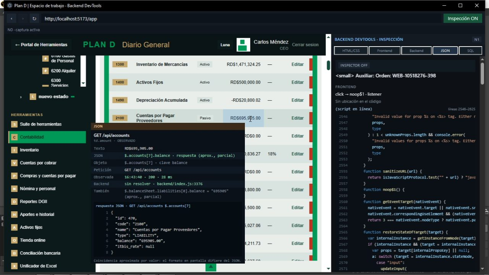

# Fullstack DevTools

Devtools de escritorio para seguir una cadena completa de una aplicación web local:

**elemento de la interfaz → manejador del frontend → petición HTTP → ruta y función del backend → consulta SQL → base de datos**

La aplicación se llama **Backend DevTools Desktop** en la interfaz; el repositorio se publica como **Fullstack DevTools**.

Licencia MIT · v0.1.0 · Desarrollado y probado en Windows

## Demostración

[](media/demo.mp4)

[Ver la demostración en video (69 s, MP4)](media/demo.mp4)

El video recorre el flujo completo sobre una aplicación local: selección del elemento, resolución del manejador del frontend, petición HTTP, ruta del backend, cuerpos JSON y consulta SQL. GitHub no incrusta video en el README; el enlace abre el reproductor del repositorio.

## Qué incluye

- **Cinco modos de inspección**: HTML/CSS, Frontend, Backend, JSON y SQL. Cada modo añade una capa de procedencia al mismo elemento seleccionado.
- **Selección exacta del elemento**: el hover y el clic usan la referencia real del evento de puntero, también dentro de Shadow DOM; el tooltip y el resaltado siguen al puntero.
- **Manejador del frontend**: listener asociado, pila de iniciadores, funciones que dispararon la petición y props de React o Vue que transportan el texto o el número.
- **Rutas del backend**: índice estático para Express, Fastify, FastAPI y Flask, con función, archivo y línea.
- **Tráfico completo**: todas las peticiones de la sesión, sin recortes, en orden cronológico, con hora, duración, ping y correlación `CLIC`/`FONDO`. Los cuerpos JSON se capturan enmascarados.
- **SQL en runtime y estático**: consultas observadas en `pg`, `mysql2`, `mysql`, `sqlite3` y `better-sqlite3`; análisis estático para MySQL, PostgreSQL y SQLite, con tablas y columnas.
- **Ejecución N2**: pausa en el manejador y código en ejecución mediante Node Inspector. La app puede arrancar el backend con `--inspect` o conectarse a uno ya arrancado.
- **Registro de actividad**: todo lo que ocurre en la sesión, en orden, con filtros por categoría.
- **Navegador integrado**: ventana propia con barra de URL, o vista embebida, con la aplicación inspeccionada aislada.
- **Editor con guardado explícito**: lectura del proyecto y edición solo cuando tú guardas.
- **Evidencia honesta**: cada dato se etiqueta como STATIC o RUNTIME; el código detectado nunca se presenta como ejecutado.

## Requisitos

- Node.js 22.22 o superior y npm.
- El proyecto a inspeccionar debe servirse en un origen local (`localhost`, `127.0.0.1` o `::1`) o en un origen añadido a la lista permitida.
- Desarrollado y probado en Windows 10/11. Electron permite macOS y Linux, pero esta versión no se ha verificado allí.

## Instalación y uso

```bash
git clone https://github.com/geoni15/fullstack-devtools.git
cd fullstack-devtools
npm install
npm run dev
```

Para ejecutar la versión compilada usa `npm start`. Para empaquetar la aplicación en una carpeta de Windows usa `npm run package:dir`.

Flujo de trabajo:

1. Abre la carpeta del proyecto; el acceso queda limitado a esa raíz.
2. Arranca el backend desde la app (se lanza con `--inspect` cuando está configurado) o conéctate a uno en marcha.
3. Carga la URL del frontend en el navegador integrado y activa «Inspección ON».
4. Haz hover sobre un elemento para ver su procedencia y clic para abrir la tarjeta de inspección.
5. Recorre los modos del panel y selecciona una petición para ver su ruta, su código, su SQL y su ejecución.

## Seguridad

- Raíces de proyecto explícitas, validadas con `realpath`; sin acceso a todo el disco.
- Escritura únicamente con guardado explícito en el editor.
- Archivos sensibles (`.env*`, claves, certificados, almacenes de credenciales) nunca se indexan, no se envían a ningún proveedor de IA y se enmascaran.
- Cabeceras sensibles (`authorization`, `cookie`, `set-cookie`, `x-api-key` y nombres con `password`, `token`, `secret`, `jwt` o `session`) siempre enmascaradas.
- Cuerpos JSON siempre enmascarados, limitados a 16 000 caracteres y solo en memoria.
- La aplicación inspeccionada corre aislada, sin acceso a IPC, Node ni al sistema de archivos.
- Servidores internos solo en loopback y lista blanca de orígenes.
- Proveedor de IA desactivado por defecto. Sin telemetría.
- Versiones exactas y `package-lock.json` versionado.

## Arquitectura

Monorepo con npm workspaces:

| Ruta                               | Rol                                                            |
| ---------------------------------- | -------------------------------------------------------------- |
| `apps/desktop`                     | Aplicación Electron: proceso principal, preload, preloads y UI |
| `packages/core/protocol`           | Tipos, canales y esquemas del protocolo IPC                    |
| `packages/browser/network-capture` | Captura y normalización del tráfico de red                     |
| `packages/analysis/routes`         | Índice estático de rutas del backend                           |
| `packages/analysis/sql-analyzer`   | Análisis estático de consultas SQL                             |

## Documentación

- [Especificación del producto](BACKEND_DEVTOOLS_DESKTOP_SPEC.md)
- [Decisiones de arquitectura (ADR)](docs/decisions.md)

## Desarrollo

```bash
npm run typecheck    # TypeScript estricto en todos los paquetes
npm run lint         # ESLint
npm run format:check # Prettier
npm test             # Pruebas unitarias (Vitest)
npm run test:e2e     # Pruebas de extremo a extremo (Playwright)
npm run verify       # typecheck + lint + formato + pruebas unitarias
```

## Limitaciones conocidas

- Prisma usa un motor propio y no expone el SQL al driver de Node: se muestra lo estático, pero no la consulta observada.
- El SQL dinámico se muestra tal como se ejecuta, sin parámetros.
- La ejecución N2 requiere un backend Node que pueda exponer Node Inspector.
- Los cuerpos JSON no persisten en disco y no se exportan.
- Solo se permite navegar a orígenes locales o añadidos expresamente a la lista permitida.

## Licencia

Distribuido bajo la licencia MIT. Consulta [LICENSE](LICENSE).
